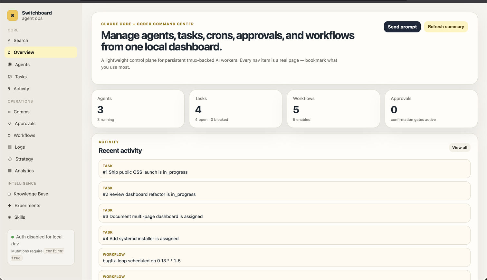

# Switchboard

**Switchboard is a local control plane for AI coding agents** — persistent Claude Code/Codex sessions, shared tasks, workflow prompts, scheduler, Telegram bridge, and a dashboard in one small Python CLI.

It is built for developers who want multiple agents working on the same repo without losing state, context, tasks, or logs.



## What it does

- register Claude/Codex agents
- start persistent tmux sessions
- send prompts into agents
- capture logs
- stop agents
- store agent state in SQLite
- queue agent-to-agent messages
- manage shared tasks with priority, repo, due dates, and comments
- store and run reusable workflow prompts
- install built-in workflow presets for review/fix/build/audit loops
- run due workflow prompts with a scheduler daemon
- handle Telegram-style commands through Hermes or a real Telegram bot
- polished multi-page web dashboard with a dedicated route for every nav item: Overview, Search, Agents, Tasks, Activity, Comms, Approvals, Workflows, Logs, Strategy, Analytics, Knowledge Base, Experiments, Skills

## Install/dev

```bash
git clone https://github.com/Aaditya2605/switchboard.git
cd switchboard
uv run --with-editable . --with pytest --with httpx pytest -q
uv run --with-editable . switchboard --help
```

Install as a local tool:

```bash
uv tool install --editable .
switchboard --help
```

## Quick demo

```bash
export SWITCHBOARD_HOME=/tmp/switchboard-demo
uv run --with-editable . switchboard init
uv run --with-editable . switchboard spawn claude builder ~/projects/myapp --dry-run
uv run --with-editable . switchboard spawn codex reviewer ~/projects/myapp --dry-run
uv run --with-editable . switchboard task add "Ship auth bugfix" --agent builder --priority high --repo ~/projects/myapp
uv run --with-editable . switchboard workflow install-presets --agent builder --profile launch
uv run --with-editable . switchboard dashboard --host 127.0.0.1 --port 8765
```

Open `http://127.0.0.1:8765`.

Full walkthrough: [`docs/DEMO.md`](docs/DEMO.md).

## Commands

```bash
uv run --with-editable . switchboard init
uv run --with-editable . switchboard agents
uv run --with-editable . switchboard spawn claude backend ~/projects/myapp
uv run --with-editable . switchboard spawn codex reviewer ~/projects/myapp
uv run --with-editable . switchboard send backend "Run tests and fix failures"
uv run --with-editable . switchboard health backend
uv run --with-editable . switchboard health --all
uv run --with-editable . switchboard dashboard --host 127.0.0.1 --port 8765
export SWITCHBOARD_DASHBOARD_TOKEN=replace-with-local-token
uv run --with-editable . switchboard dashboard --host 127.0.0.1 --port 8765 --require-token
uv run --with-editable . switchboard logs backend
uv run --with-editable . switchboard stop backend
```

Use `--dry-run` to register an agent without launching tmux:

```bash
uv run --with-editable . switchboard spawn claude backend ~/projects/myapp --dry-run
```

## Agent-to-agent comms

```bash
uv run --with-editable . switchboard msg reviewer backend "Need the API schema"
uv run --with-editable . switchboard inbox backend
uv run --with-editable . switchboard msg reviewer backend "Need the API schema" --deliver
```

## Shared task board

```bash
uv run --with-editable . switchboard task add "Fix auth" --description "Run tests first" --agent backend --priority high --repo ~/projects/myapp --due 2026-05-20
uv run --with-editable . switchboard task list
uv run --with-editable . switchboard task update 1 --priority urgent --repo ~/projects/myapp --due 2026-05-21
uv run --with-editable . switchboard task comment 1 "Waiting on API schema" --author reviewer
uv run --with-editable . switchboard task comments 1
uv run --with-editable . switchboard task assign 1 reviewer
uv run --with-editable . switchboard task move 1 in_progress
uv run --with-editable . switchboard task move 1 completed
uv run --with-editable . switchboard task list --status completed
```

## Built-in workflow presets

Switchboard ships high-value presets so the system is useful immediately:

- `daily-triage`
- `code-review`
- `bugfix-loop`
- `feature-build`
- `launch-audit`

Install them:

```bash
uv run --with-editable . switchboard workflow install-presets --agent backend --profile launch
uv run --with-editable . switchboard workflow list
uv run --with-editable . switchboard workflow run code-review
```

Preset installation upserts by workflow name, so reinstalling a profile refreshes those built-in prompts and schedules.

More details: [`docs/WORKFLOWS.md`](docs/WORKFLOWS.md).

## Custom workflow prompts

```bash
uv run --with-editable . switchboard workflow add daily-check --agent backend --prompt "Review open tasks and suggest next action" --cron "0 9 * * *"
uv run --with-editable . switchboard workflow list
uv run --with-editable . switchboard workflow run daily-check
uv run --with-editable . switchboard workflow disable daily-check
uv run --with-editable . switchboard workflow enable daily-check
```

## Scheduler

```bash
uv run --with-editable . switchboard scheduler tick
uv run --with-editable . switchboard scheduler daemon --interval 60
uv run --with-editable . switchboard scheduler install-launchd --interval 60 --dry-run
uv run --with-editable . switchboard scheduler install-launchd --interval 60
uv run --with-editable . switchboard scheduler launchd-status
uv run --with-editable . switchboard scheduler uninstall-launchd --dry-run
```

## Telegram/Hermes bridge and bot

```bash
uv run --with-editable . switchboard telegram handle "/agents"
uv run --with-editable . switchboard telegram handle "/tasks completed"
uv run --with-editable . switchboard telegram handle "/inbox backend"
uv run --with-editable . switchboard telegram handle "/health all"
uv run --with-editable . switchboard telegram handle "/send backend Run tests"
uv run --with-editable . switchboard telegram handle "/scheduler tick"

export SWITCHBOARD_TELEGRAM_BOT_TOKEN=replace-with-telegram-token
export SWITCHBOARD_TELEGRAM_ALLOWED_CHAT_IDS="123456789"
uv run --with-editable . switchboard telegram poll --once --timeout 30
uv run --with-editable . switchboard telegram set-webhook https://example.com/switchboard
uv run --with-editable . switchboard telegram webhook-info
uv run --with-editable . switchboard telegram delete-webhook
```

## Dashboard safety

The dashboard is a light operations control plane with sections for Overview, Agents, Tasks, Activity, Comms, Approvals, Workflows, Logs, Strategy, Analytics, Knowledge Base, Experiments, and Skills.

It includes functional controls for confirmed prompt sends, task moves, workflow creation/runs, log loading, table search, and summary refresh.

Set `SWITCHBOARD_DASHBOARD_TOKEN` to require bearer auth on dashboard and API requests.
Mutating API actions also require `"confirm": true` in the JSON body.

Example:

```bash
curl -H "Authorization: Bearer $SWITCHBOARD_DASHBOARD_TOKEN" http://127.0.0.1:8765/api/agents
curl -X POST -H "Authorization: Bearer $SWITCHBOARD_DASHBOARD_TOKEN" -H "Content-Type: application/json" \
  -d '{"agent":"backend","prompt":"Run tests","confirm":true}' \
  http://127.0.0.1:8765/api/send
```

Security notes: [`docs/SECURITY.md`](docs/SECURITY.md).

## Data

Default DB:

```txt
~/.switchboard/switchboard.db
```

Override for testing:

```bash
SWITCHBOARD_HOME=/tmp/switchboard-test uv run --with-editable . switchboard init
```

## Public launch checklist

Before making the repo public, run the checklist in [`docs/PUBLIC_LAUNCH_CHECKLIST.md`](docs/PUBLIC_LAUNCH_CHECKLIST.md).

## Roadmap

- screenshots/GIF demo for README
- richer dashboard editing for agents/tasks
- realtime dashboard updates
- non-macOS systemd installer
- richer collaboration analytics
